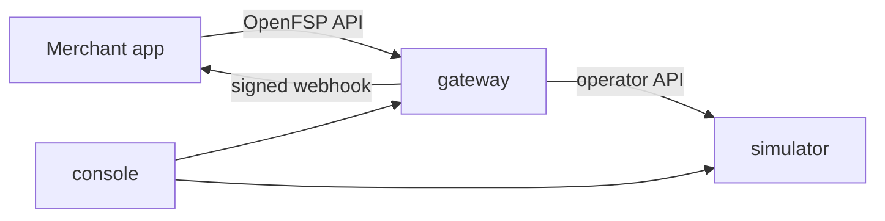

# OpenFSP gateway

The reference implementation I am building for the [OpenFSP specification](https://github.com/openfspht/adrs):
a gateway the merchant hosts, a simulator of payment operators, and a web console.



| Module | Role | Stack |
|---|---|---|
| `protocol/` | OpenFSP types shared by the gateway and the simulator | Kotlin |
| `gateway/` | OpenFSP API, operator adapters, PostgreSQL | Kotlin, Spring Boot |
| `simulator/` | Simulated operators, failure scenarios, control surface | Kotlin, Spring Boot |
| `console/` | Payments, events, webhooks and simulator controls | React, Vite, shadcn/ui |

## Run

Requires JDK 25, Docker and Bun.

```
./gradlew :simulator:bootRun          # http://localhost:8090
./gradlew :gateway:bootRun            # http://localhost:8080, starts PostgreSQL from compose.yaml
cd console && bun install && bun dev  # http://localhost:5173
```

CI runs `./gradlew build`, then `bun run lint`, `bun run typecheck` and `bun run build` in `console/`.

## License

Apache-2.0.
