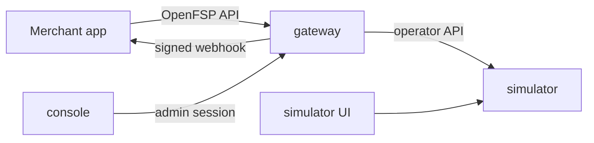

# OpenFSP stack

The reference implementation I am building for the [OpenFSP specification](https://github.com/openfspht/adrs):
a gateway the merchant hosts, its admin console, a simulator of payment operators with its own interface, a demo
merchant shop and the TypeScript client.



| Module | Role | Stack |
|---|---|---|
| `backend/protocol/` | OpenFSP types and webhook signatures, shared by every module | Kotlin |
| `backend/ddd/` | The `@DomainService` and `@Stub` annotations | Kotlin |
| `backend/gateway/domain/` | Payment, webhook, statement, auth and capability rules, with their `api` and `spi` ports | Kotlin, no framework |
| `backend/gateway/infrastructure/` | HTTP API, PostgreSQL, operator clients, webhook delivery, admin | Spring Boot |
| `backend/simulator/domain/` | Simulated operators and their scenarios | Kotlin, no framework |
| `backend/simulator/infrastructure/` | Operator API, hosted checkout, control surface | Spring Boot |
| `frontend/apps/console` | Gateway dashboard: payments, statements, keys; signed in with the admin token | React, Vite, shadcn/ui |
| `frontend/apps/simulator` | Simulator dashboard: scenarios, simulated payments, request journal, statements | React, Vite, shadcn/ui |
| `frontend/apps/shop` | Demo merchant: checkout, verified webhooks | Bun, React |
| `frontend/packages/` | Shared TypeScript config, API types, client, atomic design system | TypeScript |

Each `domain` module follows a hexagonal layout: the model and its domain services, `api/` for the use
cases, `spi/` for what they need, `spi/stubs/` for in-memory implementations. The `infrastructure`
module implements the `spi` ports and wires the domain services through a filtered component scan.

## Run

Requires JDK 25, Bun and a running PostgreSQL on `127.0.0.1:5432` with an `openfsp` role owning an `openfsp` database
(`DB_NAME`, `DB_USER` and `DB_PASSWORD` change them).

```
make install
make dev           # gateway :8080, simulator :8090, console :5173, shop :5174, simulator UI :5175
make dev-sandbox   # the same, with MonCash and NatCash on their sandboxes (PROVIDERS.md)
```

`make dev` opens a tabbed terminal (`@laravel/multiplex`), signs the console in with `demo-admin-token` and gives the shop the demo API key. `make` lists the
other targets: `hash`, `build`, `test`, `lint`, `typecheck`, `check`, `demo`.

Clients discover the endpoints at `/.well-known/openfsp-configuration`.

The console asks for the admin token. The gateway only holds its Argon2id hash, printed by the image:

```
docker run --rm -it <gateway image> hash   # prints OPENFSP_ADMIN_TOKEN='$argon2id$...'
make hash                                  # the same from the sources
```

Without `OPENFSP_ADMIN_TOKEN`, `/admin` answers the loopback only. The demo in `compose.yaml` uses the token `demo-admin-token`.

CI runs `./gradlew build` in `backend/`, then `bun run lint`, `bun run typecheck`, `bun run test` and `bun run build` in `frontend/`.

## Simulator spaces

Each validation run gets its own space in the simulator, so several runs share one public simulator without seeing
each other's payments, scenarios, automatic mode, journal or statements. `POST /runs` opens a space and returns its
random 128-bit id and base URL. Every operator and control route then also answers under `/runs/{space}/`, for example
`/runs/{space}/mock_openfsp/v1/payments` or `/runs/{space}/control/reset`, and the hosted checkout links, discovery
URLs and MonCash redirects built in a space stay in it. An unknown or expired space answers 404. A space closes on
`DELETE /runs/{space}` or after `simulator.spaces.idle-lifetime` without a request (2 hours), and its state is purged;
`simulator.spaces.capacity` bounds the open spaces (256). The unscoped routes are the default space: `make dev`, the
console and the shop use it, and it never expires.

## Validator

The validator web service runs `openfsp.validator.concurrency` runs at once (4) and answers 409 `busy` beyond. A run
takes two steps. `POST /api/runs` with `{"target":"gateway"}` opens a simulator space and returns the run id and the
operator URLs to configure on the gateway; `POST /api/runs/{id}/start` with the base URL and the keys starts it within
`openfsp.validator.prepared-run-lifetime` (1 hour). The engine connects only to the addresses checked at start.

Behind a reverse proxy, set `openfsp.validator.behind-trusted-proxy=true`: validator-web then runs with
`server.forward-headers-strategy=framework` and the per-address rate limit reads the client from `X-Forwarded-For`. The
proxy must overwrite that header with the client address, never append to it, and validator-web must not be reachable
around the proxy. The page's nginx does both in `compose.yaml`.

Running it for real: [HARDENING.md](HARDENING.md).

## License

Apache-2.0.
