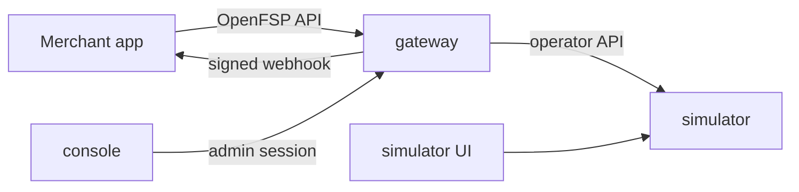

# OpenFSP gateway

The reference implementation I am building for the [OpenFSP specification](https://github.com/openfspht/adrs):
a gateway the merchant hosts, its admin console, and a simulator of payment operators with its own interface.



| Module | Role | Stack |
|---|---|---|
| `protocol/` | OpenFSP types and webhook signatures, shared by every module | Kotlin |
| `ddd/` | The `@DomainService` and `@Stub` annotations | Kotlin |
| `gateway/domain/` | Payment, webhook, statement, auth and capability rules, with their `api` and `spi` ports | Kotlin, no framework |
| `gateway/infrastructure/` | HTTP API, PostgreSQL, operator clients, webhook delivery, admin | Spring Boot |
| `simulator/domain/` | Simulated operators and their scenarios | Kotlin, no framework |
| `simulator/infrastructure/` | Operator API, hosted checkout, control surface | Spring Boot |
| `frontend/apps/console` | Gateway dashboard: payments, statements, keys; signed in with the admin token | React, Vite, shadcn/ui |
| `frontend/apps/simulator` | Simulator dashboard: scenarios, simulated payments, request journal, statements | React, Vite, shadcn/ui |
| `frontend/apps/shop` | Demo merchant: checkout, verified webhooks | Bun, React |
| `frontend/packages/` | Shared TypeScript config, API types, client, atomic design system | TypeScript |

Each `domain` module follows a hexagonal layout: the model and its domain services, `api/` for the use
cases, `spi/` for what they need, `spi/stubs/` for in-memory implementations. The `infrastructure`
module implements the `spi` ports and wires the domain services through a filtered component scan.

## Run

Requires JDK 25, Bun and a running PostgreSQL on `127.0.0.1:5432` with an `openfsp` role owning an `openfsp` database
(`DB_NAME`, `DB_USER` and `DB_PASSWORD` change them).

```
make install
make dev           # gateway :8080, simulator :8090, console :5173, shop :5174, simulator UI :5175
make dev-sandbox   # the same, with MonCash and NatCash on their sandboxes (docs/providers.md)
```

`make dev` opens a tabbed terminal (`@laravel/multiplex`), signs the console in with `demo-admin-token` and gives the shop the demo API key. `make` lists the
other targets: `hash`, `build`, `test`, `lint`, `typecheck`, `check`, `demo`.

Clients discover the endpoints at `/.well-known/openfsp-configuration`.

The console asks for the admin token. The gateway only holds its Argon2id hash, printed by the image:

```
docker run --rm -it <gateway image> hash   # prints OPENFSP_ADMIN_TOKEN='$argon2id$...'
make hash                                  # the same from the sources
```

Without `OPENFSP_ADMIN_TOKEN`, `/admin` answers the loopback only. The demo in `compose.yaml` uses the token `demo-admin-token`.

CI runs `./gradlew build`, then `bun run lint`, `bun run typecheck`, `bun run test` and `bun run build` in `frontend/`.

Running it for real: [docs/hardening.md](docs/hardening.md).

## License

Apache-2.0.
