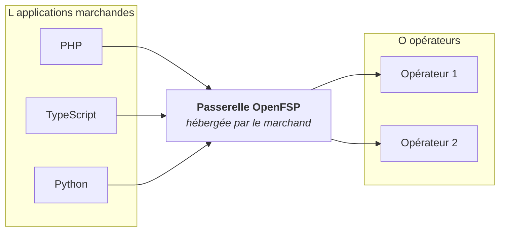

<picture>
  <source media="(prefers-color-scheme: dark)" srcset="https://cdn.openfsp.org/logo/openfsp-logo-inverse.svg">
  
</picture>

**Proposition de norme ouverte d'intégration des paiements en Haïti**

OpenFSP est le projet de recherche que je propose pour mon master MBDS : un contrat ouvert
unique entre les applications marchandes et les opérateurs de paiement numérique haïtiens.
C'est d'abord un travail académique, que j'ouvrirai ensuite à la contribution.

## L'idée

Sans contrat commun, chacune des `L` applications marchandes intègre chacun des `O`
opérateurs : `O × L` intégrations. Avec OpenFSP, chaque application parle un seul protocole
et chaque opérateur est intégré une seule fois, dans la passerelle : `O + L`.

## Composants

| Composant | Rôle |
|---|---|
| **Spécification** | Le contrat : modèle de données, cycle de vie, capacités, erreurs, idempotence, webhooks. |
| **Passerelle** | Serveur que le marchand héberge : protocole OpenFSP en entrée, API des opérateurs en sortie. |
| **Serveur simulé** | Reproduit les opérateurs, défaillances comprises, pour tester sans compte marchand. |
| **Bibliothèques clientes** | Clients minces en TypeScript, PHP et Python ; le protocole reste utilisable en HTTP seul. |
| **Suite de conformité** | Vérifie qu'une implémentation respecte la spécification ; un tiers peut la réexécuter. |

## Pour aller plus loin

Spécification et ADR : [openfspht/adrs](https://github.com/openfspht/adrs). Gouvernance :
[GOVERNANCE.md](GOVERNANCE.md). Licence : [Apache-2.0](LICENSE).

**Contribuer** : je reçois relectures et propositions par le
[processus ADR](https://github.com/openfspht/adrs), selon [CONTRIBUTING.md](CONTRIBUTING.md).
