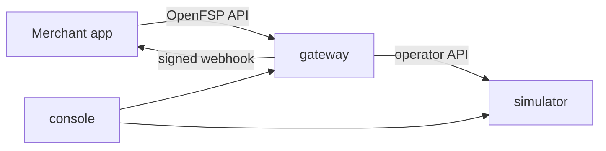

# OpenFSP gateway

The reference implementation I am building for the [OpenFSP specification](https://github.com/openfspht/adrs):
a gateway the merchant hosts, a simulator of payment operators, and a web console.



| Module | Role | Stack |
|---|---|---|
| `protocol/` | OpenFSP types and webhook signatures, shared by every module | Kotlin |
| `ddd/` | The `@DomainService` and `@Stub` annotations | Kotlin |
| `gateway/domain/` | Payment, webhook, statement, auth and capability rules, with their `api` and `spi` ports | Kotlin, no framework |
| `gateway/infrastructure/` | HTTP API, PostgreSQL, operator clients, webhook delivery, admin | Spring Boot |
| `simulator/domain/` | Simulated operators and their scenarios | Kotlin, no framework |
| `simulator/infrastructure/` | Operator API, hosted checkout, control surface | Spring Boot |
| `console/apps/web` | Payments, events, webhooks and simulator controls | React, Vite, shadcn/ui |
| `console/apps/shop` | Demo merchant: checkout, verified webhooks | Bun, React |
| `console/packages/` | Shared TypeScript config, API types, client, atomic design system | TypeScript |

Each `domain` module follows a hexagonal layout: the model and its domain services, `api/` for the use
cases, `spi/` for what they need, `spi/stubs/` for in-memory implementations. The `infrastructure`
module implements the `spi` ports and wires the domain services through a filtered component scan.

## Run

Requires JDK 25, Docker and Bun.

```
./gradlew :simulator:infrastructure:bootRun   # http://localhost:8090
./gradlew :gateway:infrastructure:bootRun     # http://localhost:8080, starts PostgreSQL from compose.yaml
cd console && bun install && bun dev  # console http://localhost:5173
OPENFSP_API_KEY=<key printed by the gateway> bun --cwd console/apps/shop dev  # shop http://localhost:5174
```

CI runs `./gradlew build`, then `bun run lint`, `bun run typecheck`, `bun run test` and `bun run build` in `console/`.

## License

Apache-2.0.
